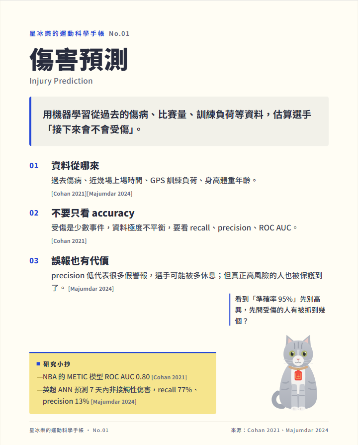
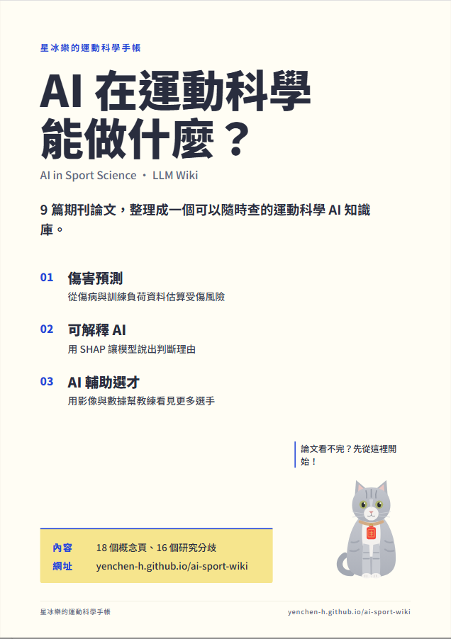
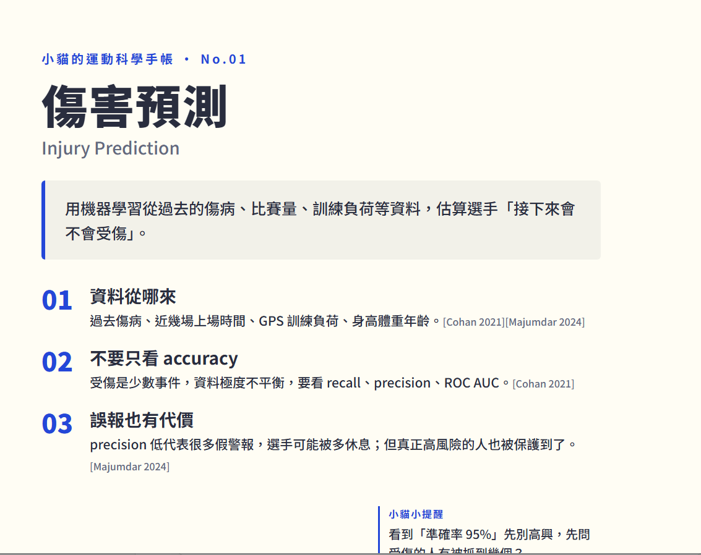

# 星冰樂的運動科學手帳

生成式人工智慧 W12 作業：**統一風格圖像產生的 Agent**

用 **Claude 專案（Projects）** 建立一個專門產生統一風格圖像的 Agent。把色調、筆觸、角色、構圖寫進專案指示，並在知識庫放入三份 HTML 模板，之後只要告訴它「用途＋內容」，就能做出同一系列的學習圖卡、海報和封面。

吉祥物是我家的英國短毛貓「星冰樂」，依照片畫成正常比例的扁平插畫，脖子上掛著牠的紅色御守。內容取自我 W10 做的 LLM Wiki [AI 在運動科學的應用](https://github.com/Yenchen-H/ai-sport-wiki)。

👉 **展示頁：** https://yenchen-h.github.io/xingbingle-sport-cards/

## 作品（同一個專案生成，三種用途、三種尺寸）

| 學習圖卡 1080×1350 | 海報 1240×1754（A4） |
|---|---|
|  |  |

**簡報封面 1920×1080（16:9）**


## 專案怎麼設定

| 項目 | 內容 |
|---|---|
| 工具 | Claude 專案 |
| 專案指示 | [project/專案指示_v2.md](project/專案指示_v2.md)（現行版本） |
| 知識庫 | [template-card.html](project/templates/template-card.html)、[template-poster.html](project/templates/template-poster.html)、[template-cover.html](project/templates/template-cover.html) |
| 下指令 | 每件作品開新對話，貼上「用途＋內容」，見 [project/生成指令.md](project/生成指令.md) |

### 風格規則重點

- **色調**：米白底 `#FFFDF4`、深灰藍文字 `#292D3E`、淡黃資訊區塊 `#F6E58D`、寶藍 `#2447D8` 只用在編號與細線
- **筆觸**：扁平設計，不用陰影、漸層、emoji、紙膠帶；區塊圓角 6px；只用直線
- **角色**：星冰樂，銀灰毛、白胸口、黃綠眼、紅色御守，正常比例、不畫 Q 版，每件作品出現一次
- **構圖**：全部靠左對齊，由上到下固定為系列名 → 大標 → 英文副標 → 內容 → 星冰樂 → 頁尾，留白至少 30%

## 風格跑掉時怎麼修正：v1 → v2

**v1：只用文字描述風格**（[專案指示_v1.md](project/專案指示_v1.md)）

生成的學習圖卡走樣了：系列名被改成「小貓的運動科學手帳」、編號變大，而且圖卡比預覽視窗大，下半部的星冰樂和研究小抄被切掉。



原因是 Claude 每次都依照文字描述重新寫 HTML，細節就會自由發揮。

**v2：改成模板制**（[專案指示_v2.md](project/專案指示_v2.md)）

- 在知識庫上傳三份 HTML 模板，指示規定「只能替換 `{{ }}` 內的文字，不可修改樣式、版面和星冰樂」
- 寫明「系列名一個字都不能改」
- 模板內建自動縮放，整張作品能在預覽視窗完整顯示
- 要求 Claude 每次輸出後回報自我檢查結果

改成 v2 後重新生成，三件作品就一致了。

## 前期風格探索

建立專案之前，我先和 Claude 一起決定風格，過程放在 [exploration/](exploration/)：

1. 第一版是手帳拼貼風，星冰樂畫成 Q 版灰藍貓，但太花，也不像我家的貓
2. 改成乾淨留白的版面，並依照片重畫星冰樂
3. 配色前後試了三組，最後選定米白配寶藍
4. 用這個風格做了 4 張學習圖卡（傷害預測、ACWR、SHAP、AI 選才），之後整理成專案指示與模板

## 資料夾

```
project/       專案指示 v1、v2，三份 HTML 模板，生成指令
works/         專案生成的三件作品，以及 v1 走樣的截圖
exploration/   前期風格探索（星冰樂 SVG、4 張學習圖卡、產圖腳本）
index.html     GitHub Pages 展示頁
```

---
本專案在 Claude 協助下完成：主題、吉祥物、風格方向與配色由我決定，Claude 協助撰寫專案指示、模板與展示頁。
